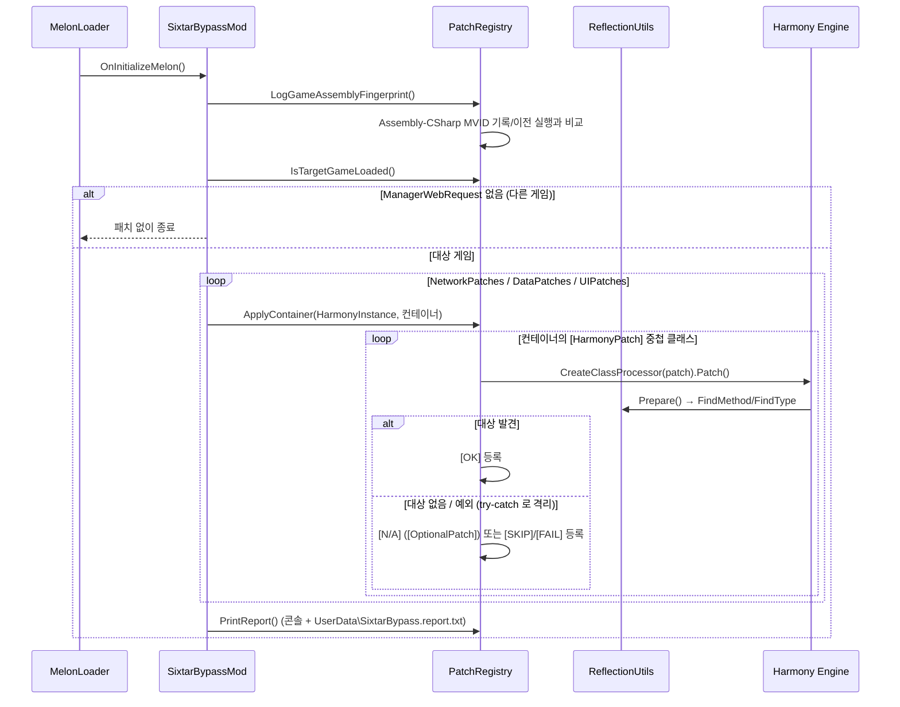

# 시스템 아키텍처 및 설계 구조 (System Architecture)

본 문서는 **Sixtar Gate: STARTRAIL — Version & Network Bypass** 모드의 아키텍처와 게임 업데이트 내성(Update Resilience) 설계를 상세히 다룹니다. (본 모드의 호환 목표 대상은 **2022년 2월 2일 ~ 2022년 8월 4일** 기간 동안 제공된 게임 버전입니다.)

---

## 1. 모드 진입점 및 초기화 흐름

모드는 `SixtarBypassMod` (`MelonMod` 상속) 클래스를 통해 진입하며, 부팅 시 다음과 같은 단계로 초기화됩니다.



버전 정보(`ModInfo.Version`)는 `SixtarBypassMod.cs` 한 곳에서만 관리하고, `MelonInfo`·`AssemblyInfo`·시작 로그가 모두 이것을 참조합니다.

---

## 2. 업데이트 내성 구조

게임 버전 업데이트로 어셈블리 구조나 메서드 시그니처가 변경되더라도 모드가 전체적으로 오작동하는 것을 방지하기 위해 다음 방어 구조를 갖추고 있습니다.

### (1) 런타임 리플렉션 탐색 (`ReflectionUtils`)
- 패치 타겟 메서드를 하드코딩된 토큰으로 지정하지 않고, `ReflectionUtils.FindMethod`로 후보 타입명 및 메서드명 목록을 탐색합니다.
- 메서드 오버로드 확장으로 `AmbiguousMatchException`이 발생하면 파라미터 수가 가장 적은 시그니처를 선택하고 경고를 남깁니다. 호출 인자가 있는 `InvokeMethod`는 인자 타입에 맞는 오버로드를 우선 고릅니다.
- `FindType`은 `Assembly-CSharp`을 우선 검색하고(전체 이름 → 짧은 이름 순), 결과를 캐시합니다. 패치 `Prefix` 안(런타임 핫패스)에서도 호출되므로 어셈블리 순회를 반복하지 않기 위해서입니다. 새 어셈블리가 로드되면 "못 찾음" 캐시만 비웁니다.
- 필드/프로퍼티 접근은 부모 클래스의 private 멤버까지 탐색하고, 실패는 같은 키당 한 번만 경고합니다.
- **컴파일 타임 참조 최소화**: 버전에 따라 사라지는 필드(`Util.tracks`/`RhythmGameUtils.trackDatas`, `UserAccountModule.runtimeCheck` 내부 필드)는 리플렉션으로 접근해, 필드가 없는 버전에서도 패치가 JIT 단계에서 깨지지 않도록 합니다.

### (2) 패치 격리 적용 (`PatchRegistry`)
- Harmony 기본 기능인 `HarmonyInstance.PatchAll()`은 패치 클래스 순회 중 단 하나의 패치에서 예외(`TypeLoadException`, `MissingMethodException` 등)가 발생해도 **전체 패치 적용이 중단**됩니다.
- 이를 방지하기 위해 `[assembly: HarmonyDontPatchAll]` 특성을 선언하여 자동 패치를 비활성화합니다.
- 대신 `PatchRegistry.ApplyContainer`가 컨테이너 클래스 안의 `[HarmonyPatch]` 중첩 클래스를 순회하며 `CreateClassProcessor(...).Patch()`를 `try-catch`로 감싸 **개별 격리 적용**합니다.
- **`[OptionalPatch]`**: 특정 게임 버전에만 대상이 존재하는 패치(신버전 전용 메서드, 구/신버전 중 한쪽 타입만 쓰는 패치)에 붙입니다. 대상이 없거나 사라진 타입 때문에 로드에 실패해도 `FAIL/SKIP`이 아닌 `N/A`로 보고되어, 진짜 문제(필수 패치의 SKIP/FAIL)가 묻히지 않습니다.

### (3) 패치 결과 리포팅 및 어셈블리 MVID 추적
- 부팅 시 어떤 패치가 성공(`OK`), 해당 없음(`N/A`), 건너뜀(`SKIP`), 실패(`FAIL`)했는지 요약 보고서를 콘솔과 `UserData\SixtarBypass.report.txt`에 출력합니다.
- `Assembly-CSharp.dll`의 `ModuleVersionId (MVID)`를 로깅하고 `UserData\SixtarBypass.fingerprint.txt`에 저장해, 다음 실행에서 값이 달라지면 "게임이 업데이트되었을 수 있다"고 경고합니다.
- 대상 게임이 아니면(`ManagerWebRequest` 타입 없음) 패치를 시도하지 않습니다. `[MelonGame(null, null)]`이라 다른 Unity 게임에도 로드될 수 있기 때문입니다. (개발사/게임 이름을 지정하면 모드가 아예 로드되지 않을 위험이 있어, 인게임 검증 없이 바꾸지 않았습니다.)

```text
---------------- Patch Report ----------------
  [OK  ] NetworkPatches.FetchServerPatch  ManagerWebRequest.FetchServer
  [N/A ] NetworkPatches.GetNewsListPatch  이 게임 버전에는 대상 없음 (신버전 전용 메서드)
  [SKIP] DataPatches.SaveUnlockCachePatch  대상 메서드를 찾지 못함
  적용 16 / 해당 없음 8 / 건너뜀 1 / 실패 0
----------------------------------------------
```

(위는 형식을 보여주는 예시이며, 패치는 총 25개입니다.)

### (4) 대체(Replacement) vs 폴백(Fallback) 방어 전략
- **폴백 방식 (`Finalizer` 이용)**:
  - 순수 방어 목적 패치(`DeserializeInventoryItemFromCSV`, `LoadFavorites` 등)는 원본 메서드를 `Prefix`로 차단하지 않고 `Finalizer`로 감쌉니다.
  - 원본 메서드가 정상 구동될 경우 원본 로직을 유지하며, 예외가 발생하거나 결과가 비어있는 경우에만 모드 구현체로 안전하게 폴백합니다.
  - 폴백 구현은 원본이 채우던 **private static 캐시**까지 같이 채워야 합니다 ([gotchas 참고](./patches-and-gotchas.md)).
- **완전 대체 방식 (`Prefix` 이용)**:
  - 서버 요청 차단, 오프라인 더미 데이터 주입처럼 원본이 실행되면 안 되는 우회 패치는 `Prefix`에서 `false`를 반환하여 원본을 완전히 대체합니다.
  - `GetTrackDataListFromCSV`도 대체 방식이며(곡을 모두 목록에 노출), 대신 컬럼 누락/불량 행에 죽지 않도록 행 단위로 격리하고 불완전한 결과는 캐시하지 않습니다.
- **서버 콜백 호출**: `PatchHelpers.InvokeWithDefault`가 콜백의 제네릭 인자 타입을 런타임에 읽어 빈 응답 객체를 만들어 넘기고, 호출 중 예외는 격리해 로그만 남깁니다.

### (5) 새 패치를 추가하는 법
1. `NetworkPatches`/`DataPatches`/`UIPatches` 중 알맞은 컨테이너에 `[HarmonyPatch]` 중첩 클래스를 만듭니다 (컨테이너는 `PatchRegistry.ApplyContainer`가 자동으로 순회하므로 등록 코드가 필요 없습니다).
2. `Prepare()`에서 `ReflectionUtils.FindMethod`로 대상을 찾아 못 찾으면 `false`, `TargetMethod()`에서 그 대상을 돌려줍니다.
3. `Prefix`/`Finalizer`의 **파라미터 이름을 원본 메서드의 파라미터 이름과 똑같이** 씁니다 (Harmony가 이름으로 바인딩).
4. 일부 버전에만 있는 메서드라면 `[OptionalPatch("이유")]`를 붙입니다.
5. 대체 방식(`Prefix=false`)으로 원본을 건너뛰면, 원본이 갱신하던 정적 캐시/부수 효과를 빠뜨리지 않았는지 확인합니다.
