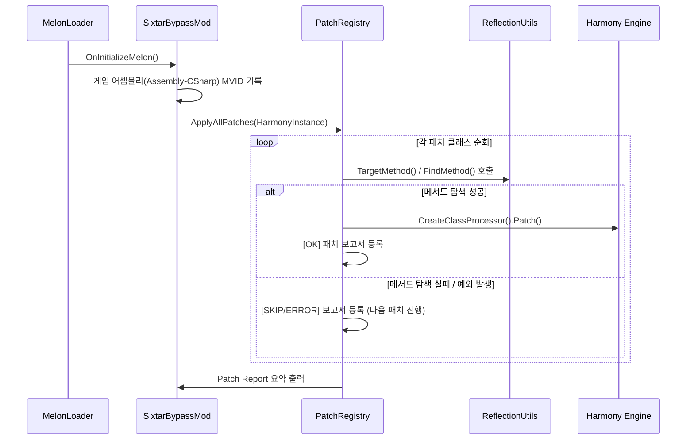

# 시스템 아키텍처 및 설계 구조 (System Architecture)

본 문서는 **Sixtar Gate: STARTRAIL — Version & Network Bypass** 모드의 아키텍처와 게임 업데이트 내성(Update Resilience) 설계를 상세히 다룹니다. (본 모드의 호환 목표 대상은 **2 February 2022 ~ 4 August 2022** 기간 동안 제공된 게임 버전입니다.)

---

## 1. 모드 진입점 및 초기화 흐름

모드는 `SixtarBypassMod` (`MelonMod` 상속) 클래스를 통해 진입하며, 부팅 시 다음과 같은 단계로 초기화됩니다.



---

## 2. 4단계 게임 업데이트 내성 구조

게임 버전 업데이트로 어셈블리 구조나 메서드 시그니처가 변경되더라도 모드가 전체적으로 오작동하는 것을 방지하기 위해 4단계 방어 구조를 갖추고 있습니다.

### (1) 런타임 리플렉션 탐색 (`ReflectionUtils`)
- 패치 타겟 메서드를 하드코딩된 토큰이나 리플렉션으로 직접 지정하지 않고, `ReflectionUtils.FindMethod`를 사용하여 후보 타입명 및 메서드명 목록을 탐색합니다.
- 메서드 오버로드 확장으로 인해 `AmbiguousMatchException`이 발생할 경우 파라미터 수가 가장 적은 시그니처를 유연하게 선택합니다.

### (2) 패치 격리 적용 (`PatchRegistry`)
- Harmony 기본 기능인 `HarmonyInstance.PatchAll()`은 패치 클래스 순회 중 단 하나의 패치에서 예외(`TypeLoadException`, `MissingMethodException` 등)가 발생해도 **전체 패치 적용이 중단**됩니다.
- 이를 방지하기 위해 `[assembly: HarmonyDontPatchAll]` 특성을 선언하여 자동 패치를 비활성화합니다.
- 대신 `PatchRegistry`에서 `CreateClassProcessor`를 이용해 각 패치를 `try-catch` 블록으로 감싸 **개별 격리 적용**을 수행합니다.

### (3) 패치 결과 리포팅 및 어셈블리 MVID 추적
- 부팅 시 어떤 패치가 성공(`OK`), 건너뜀(`SKIP`), 실패(`ERROR`)했는지 요약 보고서를 콘솔 로그에 출력합니다.
- `Assembly-CSharp.dll`의 `ModuleVersionId (MVID)`를 함께 로깅하여 실행 중인 게임 버전의 갱신 여부를 정적으로 추적합니다.

```text
---------------- Patch Report ----------------
  [OK  ] NetworkPatches.FetchServerPatch  ManagerWebRequest.FetchServer
  [SKIP] DataPatches.SaveUnlockCachePatch  대상 메서드를 찾지 못함
  적용 21 / 건너뜀 1 / 실패 0
----------------------------------------------
```

### (4) 대체(Replacement) vs 폴백(Fallback) 방어 전략
- **폴백 방식 (`Finalizer` 이용)**:
  - 순수 방어 목적 패치(`DeserializeInventoryItemFromCSV`, `LoadFavorites` 등)는 원본 메서드를 `Prefix`로 차단하지 않고 `Finalizer`로 감쌉니다.
  - 원본 메서드가 정상 구동될 경우 원본 로직을 유지하며, 예외가 발생하거나 결과가 비어있는 경우에만 모드 구현체로 안전하게 폴백합니다.
- **완전 대체 방식 (`Prefix` 이용)**:
  - 서버 요청 차단, 오프라인 더미 데이터 주입, 트랙 가시성 강제 해제 등 원본이 실행되면 안 되는 우회 패치는 `Prefix`에서 `false`를 반환하여 원본을 완전히 대체합니다.
